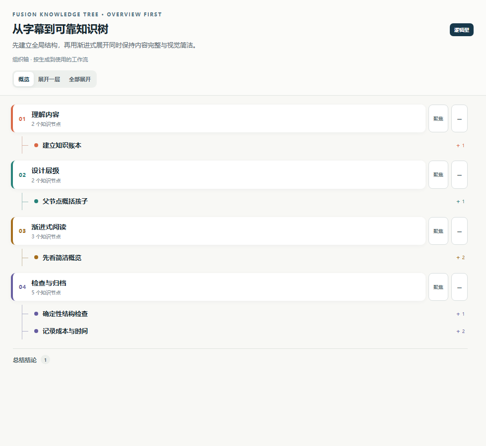
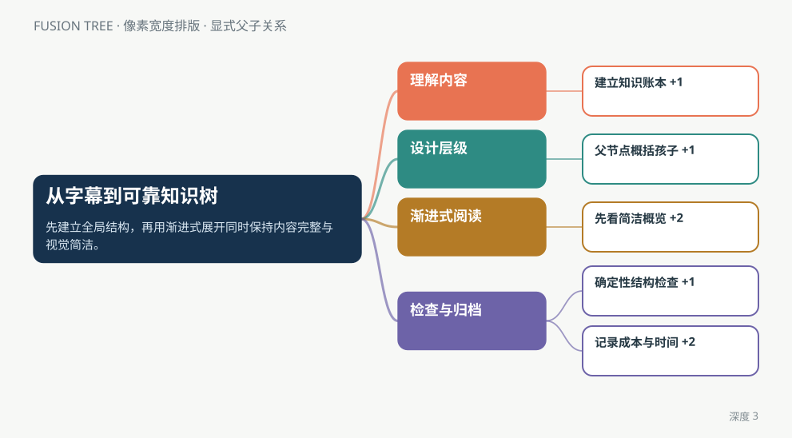

# Subtitle Knowledge Pipeline · V10

把 B 站现成 CC 字幕或本地字幕转换为两种互补成果：用于快速浏览的层级知识树，以及用于深入阅读的详细报告。知识树是本项目的核心；详细报告通过外部项目 [`video-report-agent`](https://github.com/imexlovery/video-report-agent) 接入。



<details>
<summary>查看静态知识树概览</summary>



</details>

## 核心能力

- **Skeleton First：**同一个 LLM 先通读全文、识别主题与关键词、选择组织轴并锁定主分支，再把论点、解释、例子与限定挂到已有骨架中。
- **渐进式知识树：**默认只显示主分支和顶层观点，可展开一层、全部展开或聚焦单个分支，避免把树退化成字幕要点列表。
- **树文联动：**点击树节点，右侧详细报告直接滚动并高亮对应内容；不会弹出重复的节点详情，也不会跳回原视频。
- **本地网页：**支持 B 站链接和本地字幕，可选择只生成知识树、只生成详细报告或同时生成。
- **运行可追踪：**展示实时进度并保存历史记录；每次运行标注模型调用次数、Token、耗时和可得的成本信息。
- **本地使用体验：**支持简繁切换、拖动调整树与报告宽度、双击历史记录打开完整成果，以及可选的 Obsidian 归档。
- **安全复用密钥：**Windows 本机可用 DPAPI 加密保存 API Key；明文密钥、运行历史和真实字幕均被 Git 忽略。

## 工作流程

```text
B 站 CC / 本地字幕
        ↓
带稳定 source_units 的 canonical transcript
        ├── 知识树：主题与术语 → 组织轴 → 主干 → 内容挂载 → HTML / SVG / PNG
        └── 详细报告：所选报告引擎 → HTML / PNG
                              ↓
                 树节点定位报告段落
                              ↓
                   历史记录 / Obsidian
```

知识树使用两次同模型调用：

1. **骨架阶段：**识别主题、规范术语、整理核心内容清单、比较候选组织轴并生成主分支。
2. **挂载阶段：**锁定组织轴和主分支，为内容选择父节点并补充必要细节。

程序随后检查 JSON 结构、父节点引用、层级连续性、内容清单归属和页面溢出。这些是确定性检查，不被当作“模型一定理解正确”的证明；项目也不会额外调用第二个 LLM 充当评审。

## 快速开始

### 1. 准备环境

- Windows
- Python 3.12
- Node.js 22
- [`uv`](https://docs.astral.sh/uv/)
- 与本仓库同级放置 `video-report-agent`

```text
workspace/
├── video-report-agent/              # 外部详细报告依赖
└── subtitle-knowledge-pipeline/      # 本项目
```

```powershell
git clone https://github.com/imexlovery/video-report-agent.git
git clone https://github.com/shakeshakehin/subtitle-knowledge-pipeline.git
cd subtitle-knowledge-pipeline
uv sync --dev
```

### 2. 启动网页

```powershell
.\run-fusion.ps1 serve
```

打开 [http://127.0.0.1:8766/](http://127.0.0.1:8766/)。第一次使用时在网页中输入 DeepSeek API Key；本机模式可选择加密保存，之后直接从已有 Key 中选择。

### 3. 生成成果

网页中粘贴 B 站链接或选择本地字幕，再选择“知识树”“详细报告”或两者同时生成。也可以使用命令行：

```powershell
# B 站视频
.\run-fusion.ps1 run BVxxxxxxxxxx

# 本地字幕
.\run-fusion.ps1 run "E:\path\subtitle.txt" --title "视频标题"
```

常用选项：

- `--output tree|report|both`：选择输出内容。
- `--report-engine editorial|efficient|legacy`：选择详细报告引擎。
- `--no-publish`：只保存在当前工作区，不归档到 Obsidian。
- `--force`：忽略已缓存字幕，重新读取来源。

## 产物与历史

每次运行保存在 `runs/<时间-来源>/`，其中主要包括：

- `tree.html`：可折叠、可聚焦、可定位报告的知识树。
- `mindmap-overview.svg/png`：适合快速浏览的静态树图。
- `report.html/png`：详细报告。
- `skeleton.json`、`outline.json`：两阶段知识树结构。
- `usage.json`、`run.trace.jsonl`：Token、调用次数、耗时与本地执行记录。

字幕一旦成功读取就会先写入本地缓存。即使后续模型或渲染失败，再次处理同一视频时也会优先复用已有字幕。

## 设计边界

- 只使用 B 站已有 CC 字幕，不提供本地 faster-whisper fallback。
- 不启用第二个 LLM，也不按风险触发额外语义校验。
- 来源 ID 用于树与报告定位，不代表事实真实性或语义正确性。
- 分支数和深度不设武断的固定答案；层级由内容、组织轴和父子关系决定。
- Obsidian 归档是可选项，不影响本地生成和历史记录。

## 可观测性与评测

项目始终保存本地 trace；配置自托管 Langfuse 后，可进一步查看每个阶段、每次 LLM 调用、Prompt、输出、Token、耗时、校验失败和重试。Langfuse 不可用不会阻断生成流程。

仓库也提供人工金标准与 A/B 盲测工具，用于检查编造、遗漏、父子逻辑、分支滥用和成本。真实字幕、人工标注与评测结果只保存在本地，不随公开仓库发布。使用方法见 [benchmark/README.md](benchmark/README.md)。

## 第三方来源与许可

本仓库实现知识树生成与检查、树文联动、本地网页、历史记录、进度追踪、评测和 Obsidian 归档。详细报告能力依赖外部 [`imexlovery/video-report-agent`](https://github.com/imexlovery/video-report-agent)，本仓库不复制或重新分发其源代码。

具体边界见 [THIRD_PARTY_NOTICES.md](THIRD_PARTY_NOTICES.md)，密钥与隐私说明见 [SECURITY.md](SECURITY.md)。本项目自有代码采用 [MIT License](LICENSE)；该许可不替第三方项目授予权利。
